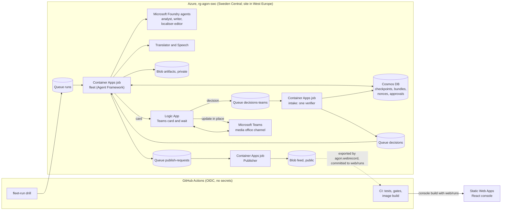

# Agon

**Agon publishes nothing until the club's media officer approves the exact checked bundle in Microsoft Teams, so a one-person media office can put out a match report in four languages, with audio and an English easy-read edition, without copying numbers by hand or waiting for translators.**

Live demo, no login: https://jolly-stone-0c9c8a003.4.azurestaticapps.net

Agon (the contest) is our entry to the Microsoft Inside the Game developer hackathon. It serves the small media office of a professional football club. Every club, player and match in it is synthetic and fictional. MIT licence.

## Who it is for, where it lands, what it replaces

* **Who:** the few people in a club media office who must publish the match report, translated supporter bulletins, accessible versions and a feed item for the club website soon after full time.
* **Where it lands:** the media office's Microsoft Teams channel. When a match is over, a run starts (today an operator dispatches it, because there is no live match feed) and an approval card arrives there; the officer asks for nothing. It shows the bundle hash, the editions, the English report the officer attests, the sentences that need a tick, and the destinations to publish to. One tap publishes those exact bytes to the club website feed (recap page, JSON Feed and RSS); the Instagram and YouTube payloads are previews that are never posted, and the newsroom Teams post and the journalist email are written but not sent.
* **What it replaces:** writing the report by hand after the match while copying numbers from a stats sheet, waiting for volunteer translators, and skipping easy-read and audio editions.

## Why Microsoft is load-bearing

Microsoft Foundry agents (analyst, writer, localiser-editor), run as a Microsoft Agent Framework workflow, write the report and post-edit every translation, and the workflow waits in a durable checkpoint until the media officer approves in Microsoft Teams. Take Foundry out and no report exists; take the Agent Framework checkpoint out and an approval cannot survive the process ending; take Teams out and nothing can publish to the club feed in this deployment.

## A real run, end to end (2026-10-19)

Everything below ran inside our Azure resource group. The four job executions (21:19:06, 21:24:36, 21:25:06, 21:25:36) are in [`evidence/run-c8a19020c98a.executions.json`](evidence/run-c8a19020c98a.executions.json), read with `az containerapp job execution list`; the queued run is in the [drill run](https://github.com/upgradedev/agon-azure/actions/runs/39326468664) log, and its run id in that file carries the time. The two Logic App times (21:20:30 and 21:26:08) were read from the Logic App run history, which is not public. Anyone can check the published bundle from the public files.

| Time (UTC) | Step |
|---|---|
| 21:18:59 | A run for synthetic seed 1, match 0 is put on the `runs` queue ([drill run](https://github.com/upgradedev/agon-azure/actions/runs/39326468664); run id `drill-20261019T211859Z-39326468664`). |
| 21:19:06 | The fleet job wakes. Foundry agents `agon-analyst:1`, `agon-writer:1` and `agon-localiser-editor:1` write the report; Azure AI Translator and Azure AI Speech make the Greek, Spanish and French editions and the audio; code applies the easy-read rules; code recomputes every claimed score, statistic, minute and player name from the event log, refuses any number written in digits that no claim carries, and blocks real names (spelled-out numbers, decimals and club names not tied to a cited event are not checked; see M8 below); the bundle is sealed as sha256 `c8a19020c98a8de7dab58475bc0b2466129d3de771e30fd8ec519ab2716382dd`. This run's interpret step was the stand-in `fleet-local-standin/1`. |
| 21:20:30 | The approval card is posted to the club's Teams channel by an Azure Logic App (time from the Logic App run history, not in the public evidence). The worker process ends; the workflow waits in its checkpoint. |
| about 21:24 | The media officer approves in Teams. The decision goes to the `decisions-teams` queue, which only the Logic App's identity may write. |
| 21:24:36 | The intake job runs the one verifier: nonce unused, not expired, approver role, hash equal to the sealed hash, consume once. |
| 21:25:06 | A new fleet process resumes the workflow from the checkpoint and asks for the publish. |
| 21:25:36 | The Publisher job recomputes the hash from the bytes, reads the approval record, and writes create-only to the public feed: recap page, JSON Feed and RSS, Instagram and YouTube previews (never posted), and the newsroom and journalist payloads (written, not sent). |
| 21:26:08 | The same Teams card is updated in place to "Published" (time from the Logic App run history, not in the public evidence). |

Check it yourself: the [published manifest](https://stagonnnk4re3nvfz7o.blob.core.windows.net/feed/c8a19020c98a8de7dab58475bc0b2466129d3de771e30fd8ec519ab2716382dd/manifest.json) hashes to the approved hash (`sha256sum`). The console's Verify page recomputes, in your browser, the sha256 of every file of the copy of this run that is committed under `web/runs` and served with the site.

## Real, simulated, not deployed

| Part | State |
|---|---|
| Synthetic league, season and matches (seeded, deterministic, standard library only) | real, in CI and on the site |
| Foundry agents writing the report, Translator, Speech | real, deployed in Sweden Central |
| Agent Framework workflow with Cosmos DB checkpoints, resumed in a new process | real, deployed (Container Apps jobs) |
| Teams approval card, updated in place after publish | real, deployed (Logic Apps Consumption) |
| One verifier for every approval route; consume once | real, deployed in the intake job; Teams is the only deployed route |
| Publisher, one adapter per destination, create-only writes | real, deployed |
| Club website recap, JSON Feed and RSS | real, published to the public feed container |
| English easy-read edition | real, by code (`easy_read` in `src/agon/fleet/steps.py`): an English sentence of 20 words or fewer with no listed idiom, semicolon or round bracket is kept as written; any other becomes a template line built from its claims, or a withheld line. In the recorded run every sentence was kept, so its prose equals the English prose |
| Instagram and YouTube | preview payloads only: not posted; posting needs Meta and Google app approval |
| Newsroom Teams post and journalist email digest | payloads written, not sent: the newsroom post flow (`la-agon-teams-post`) is deployed but no code calls it yet; the journalist email send flow is not built |
| Outlook approval email | built; not deployed until the officer authorises the Outlook connection |
| Public console | real; the approval card on it is a stand-in that sends no decision in this public build |
| Live run started from the public page, sandbox publish | not deployed yet: there is no HTTP API or public decision endpoint, and a sandbox run is decided only on the console stand-in, which sends nothing, so nothing reaches the deployed sandbox publisher job yet |
| Interpret metrics (xG, xT, PPDA, win probability) feeding the agents | the recorded run sealed a stand-in interpret step (`fleet-local-standin/1` in its manifest); the fleet on main has since switched to `agon.interpret` (`src/agon/fleet/interpret_port.py`), and no published run has used it yet, so no report claim rests on these metrics yet |
| Signed approval link, Key Vault signing, Foundry evaluations, erratum and scorer-correction runs, automatic start at match end, Match-Day Charter cues (the charter is not approved yet), Event Hubs, replayer, matchfacts MCP server (in the repo and contract-tested; the fleet does not use MCP) | not deployed |

## Architecture



The console never reads the feed: its content security policy allows connections to its own origin only, and it serves the committed copy of the recorded run.

Each job has its own managed identity and only the grants it needs:

* The fleet may only create nonce documents, never update one. Cosmos DB roles cannot restrict fields, so it could create a nonce that already reads consumed; the intake turns such a nonce into an approval only when its consumed block is exactly what the verifier would write for the officer's real decision, with times inside that request. What stays open: a planted block equal to the officer's real decision is recorded with times the planter chose (`src/agon/governance/verifier.py`).
* Only the intake, as `id-api`, can consume a nonce and record an approval, and only `id-api` may send on the verified `decisions` queue the fleet resumes from.
* Only the Logic App's identity may write the inbound decision queues (`decisions-teams`, `decisions-outlook`).
* Only the Publisher may write the public feed.

Calls to Storage (queues and blobs), Cosmos DB, Foundry, Translator, Speech and the Logic App triggers use managed identities, and Storage, Cosmos DB, Foundry, Translator and Speech have key auth disabled. Credentials that remain include these, none held by our job code: the Logic Apps reach Teams through the `agon-teams` API connection, an OAuth connection the owner authorised; the Container Apps environment sends logs with the Log Analytics workspace key (`infra/modules/containerenv.bicep`); the Foundry project sends traces to Application Insights through its connection string (`infra/modules/foundry.bicep`); and on the CI side the deploy reads the Static Web Apps deployment token to publish the site (`.github/workflows/deploy.yml`), while every Azure call from CI signs in with OIDC.

## Numbers (self-measured)

Run each command from the repository root. `PYTHONPATH=src` is the bash form; in PowerShell run `$env:PYTHONPATH = 'src'` once and drop the prefix.

| What | Value | Command and run |
|---|---|---|
| Same synthetic data on two operating systems (M1) | seeds 1 to 3 combined sha256 `1dc93944eadc37731416524a588b5c309120e2fdc9b058baf62aed6815e36ebc` on ubuntu-latest and windows-latest; season 1 sha256 `0d5a4629fee516f8170e9aedc6c1a34272ce1939fb4dfb8df3b4825ca226b8db` on both | `PYTHONPATH=src python -m agon.synth.manifest --seeds 1,2,3 --print-hash`; `PYTHONPATH=src python -m agon.synth.season --season 1 --print-hash`; [determinism run](https://github.com/upgradedev/agon-azure/actions/runs/39330327746) |
| Realism bands on 200 held-out matches (M2) | 18 of 22 pass; our target was 20, so this is below target and no band was widened | `PYTHONPATH=src python -m agon.synth.bands --seeds 1001-1200` (prints `M2 passed 18 of 22 (threshold 20)` and exits 1, because the result is below target) |
| Approval routes that skip the verifier (M16) | 0 (4 channel adapters, 2 queue routes) | `PYTHONPATH=src python -m agon.governance.routes`; [governance run](https://github.com/upgradedev/agon-azure/actions/runs/39330327770) |
| 50 concurrent approvals of one nonce (M15) | 1 approval. Negative control: an etag-blind store lets all 50 consume the nonce, and only the create-only approval record still holds it to 1 approval and 1 publish. Measured on the in-memory store with etag compare-and-set; the Cosmos DB etag path is not exercised by this test | `PYTHONPATH=src python -m pytest tests/approval_concurrency -q` (prints `3 passed`; needs pytest from `requirements/dev.txt`); [governance run](https://github.com/upgradedev/agon-azure/actions/runs/39330327770) |
| Approval across process death | the 2026-10-19 run resumed in a new Container Apps execution; the CI spike kills the waiting process, resumes in another, and proves a deleted checkpoint cannot resume | [spike run](https://github.com/upgradedev/agon-azure/actions/runs/39229376155) |
| Foundry model call from CI (gate C2) | HTTP 200 from the luna deployment, 1409 ms, 35 tokens | [foundry-smoke run](https://github.com/upgradedev/agon-azure/actions/runs/39276078687) |
| Turning-point recall (M7) | not built yet | none |
| Fact Gate catch rate by language (M8), seeded mutants of every sentence of the recorded run | self-measured, `check_sentence`: 185 of 225 caught (82.2%), the same 37 of 45 in en, el, es and fr. The easy-read edition's prose equals the English prose in this run, so it is not a separate language result. All 16 misses a real run can produce are club names: 6 claimed club names with no cited event in en, and an unclaimed club name in s1 and s3 of every edition. Spelled-out numbers (0 of 30 flagged) and decimals are uncovered by design and not counted | `PYTHONPATH=src python -m agon.governance.mutation --run web/runs/run-c8a19020c98a` (seed 8), pinned by `tests/governance/test_mutation.py`, on main since #53; [governance run](https://github.com/upgradedev/agon-azure/actions/runs/39356938557) |
| M8 translation stage: el, es and fr prose mutated, claims copied from English as the pipeline copies them, gated as `factgate_lang` does | self-measured: 95 of 101 caught (94.1%): el 32 of 34, es 32 of 34, fr 31 of 33; the 6 misses are the unclaimed club names. The claims-equality check in `check_translation` is defence in depth, because editions carry the English claims by code | the same command, section "Translation stage"; [governance run](https://github.com/upgradedev/agon-azure/actions/runs/39356938557) |

These numbers come from our own runs and are labelled as such; nobody else has measured them.

## Run it

Nothing needs installing on your machine to browse the demo. To check the code, the generator and the gates need only Python 3.11 or later and its standard library (`ci/check_dashes.py` also needs git, because it lists the tracked files). From the repository root, put `src` on the import path (bash shown; in PowerShell run `$env:PYTHONPATH = 'src'` once and drop the prefix):

```
PYTHONPATH=src python -m agon.synth.manifest --seeds 1,2,3 --print-hash
PYTHONPATH=src python -m agon.governance.routes
python ci/check_dashes.py
```

They print `combined sha256 1dc93944...`, `routes that skip verify(): 0` and `problems: 0`. `ci/web_check.py` checks the built console, so it runs in GitHub Actions (`console.yml`, `deploy.yml`) after the console build; the hand-written page in `web/` is only its test fixture now.

The full test suite, the Agent Framework tests, the Azure SDK contract tests and the console build run in GitHub Actions (`.github/workflows/`). Deployment is Bicep (`infra/`) applied by the deploy workflow with a GitHub OIDC identity that holds Contributor on one resource group; Azure role assignments are in `infra/rbac.bicep` and are applied by the subscription owner. `docs/OPERATIONS.md` has every step.

## Honest limits

* One approver role, set by the subscription owner; the approver identity comes from the Teams responder field the Logic App forwards, a stated trust boundary.
* Foundry groundedness evaluation is not run yet. The Greek, Spanish and French editions are checked by the deterministic Fact Gate, not by a model.
* No penetration test, no multi-tenancy, no watermark in the audio. AI authorship is disclosed on every published page and at the start of every audio file.
* The realism score (M2) is below our own target.

## Open-source tooling

Python: pytest and its dependencies, setuptools, Microsoft Agent Framework (`agent-framework-core`, `agent-framework-foundry`, `agent-framework-openai`, `agent-framework-azure-cosmos`), `azure-ai-projects`, `azure-ai-inference`, `openai`, `aiohttp`, the Azure SDK (`azure-cosmos`, `azure-identity`, `azure-core`, `azure-storage-queue`, `azure-storage-blob`) and the MCP Python SDK (`mcp`). Exact versions are pinned in `requirements/` and `pyproject.toml`. The job image starts from the official `python` slim image (`Dockerfile`). CI uses the gitleaks container image and the GitHub Actions `actions/checkout`, `actions/setup-python`, `actions/setup-node`, `actions/upload-artifact`, `actions/download-artifact`, `azure/login` and `Azure/static-web-apps-deploy`. The video workflows use ffmpeg and the DejaVu fonts from the Ubuntu archive, espeak-ng for the stand-in rehearsal narration only, and Playwright's Chromium, which the console workflow also uses.

Console (`console/`), exact versions in `console/package.json` and `console/package-lock.json`: React and React DOM, TypeScript, Vite and @vitejs/plugin-react, Tailwind CSS and @tailwindcss/vite, Radix UI primitives (@radix-ui/react-dialog, @radix-ui/react-popover, @radix-ui/react-tooltip), Lucide icons (lucide-react), the Inter typeface through @fontsource-variable/inter, Vitest, Playwright (@playwright/test), axe-core through @axe-core/playwright, and the type packages @types/react, @types/react-dom and @types/node.

The public console is built from `console/` in a job with no Azure identity, prerendered into static HTML, checked by `ci/web_check.py` and the live readiness gate, and served by Azure Static Web Apps under a strict content security policy with Trusted Types.
