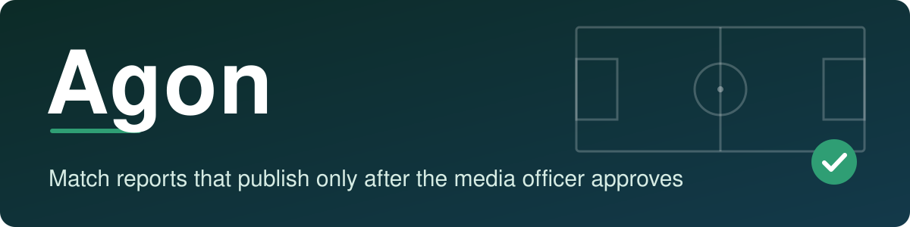
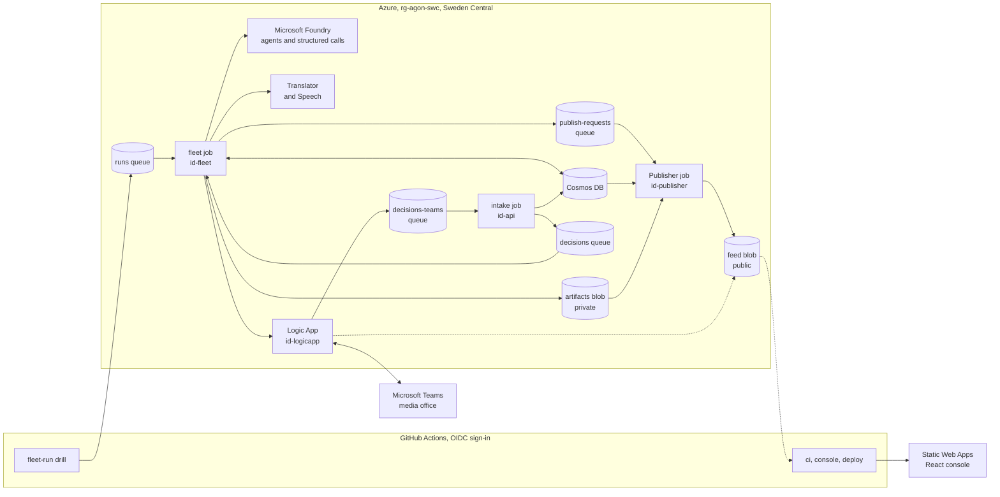
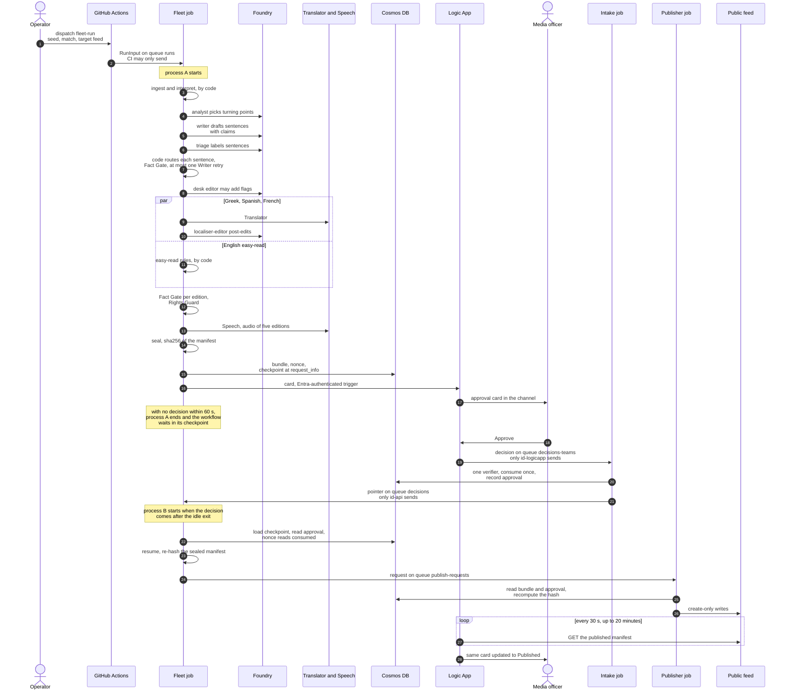
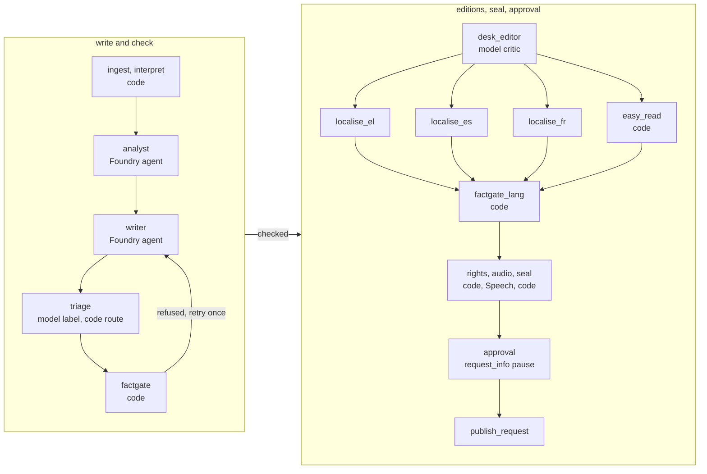

# Agon

[](https://github.com/upgradedev/agon-azure/actions/workflows/ci.yml?query=branch%3Amain)
[](https://github.com/upgradedev/agon-azure/actions/workflows/deploy.yml?query=branch%3Amain)
[](https://github.com/upgradedev/agon-azure/actions/workflows/determinism.yml?query=branch%3Amain)
[](https://github.com/upgradedev/agon-azure/actions/workflows/governance.yml?query=branch%3Amain)
[](LICENSE)
[](pyproject.toml)
[](https://jolly-stone-0c9c8a003.4.azurestaticapps.net)
[](DATASET_CARD.md)
[](https://youtu.be/Kq4-5EawTNY)

**Agon publishes nothing until the club's media officer approves the exact checked bundle in Microsoft Teams, so a one-person media office can put out a match report in four languages, with audio and an English easy-read edition, without copying numbers by hand or waiting for translators.**

[Live demo](https://jolly-stone-0c9c8a003.4.azurestaticapps.net) · [Video (1:51)](https://youtu.be/Kq4-5EawTNY) · [Try it in 2 minutes](#try-it-in-2-minutes) · [Architecture](#architecture) · [Process flow](#process-flow-of-one-run) · [Agents and checks](#the-agents-and-who-checks-them) · [How to judge](#how-to-judge-agon-against-the-rubric) · [Documentation map](#documentation-map)

Agon (the contest) is our entry to the Microsoft Inside the Game developer hackathon. It serves the small media office of a professional football club. Every club, player and match in it is synthetic and fictional. MIT licence.

## Try it in 2 minutes

Live demo, no login: https://jolly-stone-0c9c8a003.4.azurestaticapps.net

1. **Match Centre.** Pick a synthetic match and switch between **Fan** and **Analyst** under "Your view": Fan mode tells the match in plain words, Analyst mode shows every chart, the full team scorecard and every player. Then press **Blow full time**. Live agents are not connected to the public page, so it opens the recorded run, and every screen labels it as recorded.
2. **Newsroom Wall** (nav: Newsroom). What each desk did at full time, the bundle state walking DRAFT, CHECKED, SEALED, AWAITING_APPROVAL, and the verdict of every deterministic gate. Replay steps through the run.
3. **Approve.** The approval card as the officer sees it. On the public site it is a stand-in that sends no decision.
4. **Recap**, with **Listen**: the English, Greek, Spanish, French and English easy-read editions, and the audio of each.
5. **Verify.** Your browser downloads the sealed manifest and every file it lists, hashes the bytes it received with WebCrypto, and compares them with the manifest and with the approved hash.
6. **Media office** (under More): run status, the job executions read from Azure, what was delivered in which language and where, and the approval audit trail.
7. **How it works** (under More): the pipeline stage by stage and what of it ran in Azure for the recorded run, each stage with its evidence.

Re-hash the public feed yourself: download the [published manifest of the run the console opens by default](https://stagonnnk4re3nvfz7o.blob.core.windows.net/feed/0e16414b71d73a7c6a014f0fb5223db18dacfc64fa487fb0a90a09d3bbca1e5f/manifest.json) and run `sha256sum manifest.json`. It prints `0e16414b71d73a7c6a014f0fb5223db18dacfc64fa487fb0a90a09d3bbca1e5f`, the hash the officer approved.

Video (1:51, English captions): https://youtu.be/Kq4-5EawTNY. It opens with the problem and the flow, then shows the run the console opens by default, from the card arriving in Teams to the approved hash equalling the published hash.

## Contents

1. [Who it is for, where it lands, what it replaces](#who-it-is-for-where-it-lands-what-it-replaces)
2. [Why Microsoft is load-bearing](#why-microsoft-is-load-bearing)
3. [Architecture](#architecture)
4. [Process flow of one run](#process-flow-of-one-run)
5. [The agents and who checks them](#the-agents-and-who-checks-them)
6. [A real run, end to end (2026-10-19)](#a-real-run-end-to-end-2026-10-19)
7. [Later real runs (2026-10-20 and 2026-10-27)](#later-real-runs-2026-10-20-and-2026-10-27)
8. [Real, simulated, not deployed](#real-simulated-not-deployed)
9. [Numbers (self-measured)](#numbers-self-measured)
10. [How to judge Agon against the rubric](#how-to-judge-agon-against-the-rubric)
11. [Run it](#run-it)
12. [Honest limits](#honest-limits)
13. [Documentation map](#documentation-map)
14. [Open-source tooling](#open-source-tooling)

## Who it is for, where it lands, what it replaces

* **Who:** the few people in a club media office who must publish the match report, translated supporter bulletins, accessible versions and a feed item for the club website soon after full time.
* **Where it lands:** the media office's Microsoft Teams channel. When a match is over, a run starts (today an operator dispatches it, because there is no live match feed) and an approval card arrives there; the officer asks for nothing. It shows the bundle hash, the editions, the English report the officer attests, the sentences that need a tick, and the destinations to publish to. One tap publishes those exact bytes to the club website feed (recap page, JSON Feed and RSS); the Instagram and YouTube payloads are previews that are never posted, and the newsroom Teams post and the journalist email are written but not sent.
* **What it replaces:** writing the report by hand after the match while copying numbers from a stats sheet, waiting for volunteer translators, and skipping easy-read and audio editions.

## Why Microsoft is load-bearing

Microsoft Foundry agents (analyst, writer, localiser-editor), run as a Microsoft Agent Framework workflow, write the report and post-edit every translation, and the workflow waits in a durable checkpoint until the media officer approves in Microsoft Teams. Take Foundry out and no report exists; take the Agent Framework checkpoint out and an approval cannot survive the process ending; take Teams out and nothing can publish to the club feed in this deployment.

| Microsoft or Azure technology | What Agon uses it for | Where |
|---|---|---|
| Microsoft Foundry | three prompt agents (`agon-analyst`, `agon-writer`, `agon-localiser-editor`) and two structured-output calls (triage, desk editor) | `src/agon/agents/foundry.py`, `infra/modules/foundry.bicep` |
| Microsoft Agent Framework | the full-time workflow graph, its human approval pause (`request_info`) and the resume from that checkpoint, in a new process when the waiting one has already exited | `src/agon/fleet/workflow.py`, `src/agon/fleet/checkpoints.py` |
| Azure AI Translator and Azure AI Speech | Greek, Spanish and French machine translation; audio for five editions | `src/agon/agents/translator.py`, `src/agon/agents/speech.py` |
| Microsoft Teams and Azure Logic Apps | the approval card, the wait for the officer's answer, the card updated in place after publish | `infra/flows.bicep` (`la-agon-teams-approval`) |
| Azure Container Apps jobs | fleet, intake and Publisher, each started by a message on its own Storage queues | `infra/apps.bicep` |
| Azure Cosmos DB | workflow checkpoints, sealed bundles, nonces, approval records | `infra/modules/cosmos.bicep`, `src/agon/governance/store_cosmos.py` |
| Azure Storage | the work queues, private artifacts and the public feed | `infra/modules/storage.bicep` |
| Azure Static Web Apps | the public React console | `console/`, `infra/modules/staticsite.bicep` |
| Managed identities, Entra ID, GitHub OIDC | keyless calls from every job; CI signs in to Azure with OIDC | `infra/rbac.bicep`, `.github/workflows/deploy.yml` |

## Architecture

Only deployed parts are drawn. Each Container Apps job and the Logic App runs under its own managed identity, named on the second line of its box; the table under the diagram names each resource.



| In the diagram | Azure resource and what it does |
|---|---|
| fleet job | Container Apps job `job-agon-fleet`, identity `id-fleet`: runs the Agent Framework workflow to the approval pause and posts the card through the Logic App's Entra-authenticated trigger. When no decision arrives within the worker's 60 s idle window (`--idle-exit 60`), the process ends and a new process resumes the workflow from the checkpoint; a decision that comes sooner is resumed by the same process |
| Microsoft Foundry | prompt agents `agon-analyst`, `agon-writer`, `agon-localiser-editor`; structured-output calls for triage and the desk editor |
| Translator and Speech | Azure AI Translator (Greek, Spanish, French) and Azure AI Speech (audio of five editions) |
| Cosmos DB | workflow checkpoints, sealed bundles, nonces and approval records |
| Logic App | `la-agon-teams-approval`, identity `id-logicapp`: posts the card through the `agon-teams` connection, waits for the answer, sends it unchanged to `decisions-teams` (only `id-logicapp` may send there), polls the published manifest and updates the card in place |
| intake job | Container Apps job `job-agon-intake`, identity `id-api`: the one verifier; consumes the nonce, records the approval, and is the only sender on `decisions` |
| Publisher job | Container Apps job `job-agon-publisher`, identity `id-publisher`: re-hashes the bundle, reads the approval record, writes create-only to the public `feed` container |
| fleet-run drill | the `fleet-run.yml` workflow, run by an operator; on Storage the CI identity may only send, and only to the `runs` queue |
| Static Web Apps | the public React console, in West Europe, built from the committed copies of the recorded runs in `web/runs` (exported by `agon.webrecord`) |

Deployed but not drawn, because no run reaches them yet: the sandbox Publisher job (`job-agon-publisher-sandbox`) and the newsroom post flow (`la-agon-teams-post`). The console never reads the feed: its content security policy allows connections to its own origin only, and it serves the committed copies of the recorded runs.

Each job has its own managed identity and only the grants it needs:

* The fleet may only create nonce documents, never update one. Cosmos DB roles cannot restrict fields, so it could create a nonce that already reads consumed; the intake turns such a nonce into an approval only when its consumed block is exactly what the verifier would write for the officer's real decision, with times inside that request. What stays open: a planted block equal to the officer's real decision is recorded with times the planter chose (`src/agon/governance/verifier.py`).
* Only the intake, as `id-api`, can consume a nonce and record an approval, and only `id-api` may send on the verified `decisions` queue the fleet resumes from.
* Only the Logic App's identity may write the inbound decision queues (`decisions-teams`, `decisions-outlook`).
* Only the Publisher may write the public feed.

Calls to Storage (queues and blobs), Cosmos DB, Foundry, Translator, Speech and the Logic App triggers use managed identities, and Storage, Cosmos DB, Foundry, Translator and Speech have key auth disabled. Credentials that remain include these, none held by our job code: the Logic Apps reach Teams through the `agon-teams` API connection, an OAuth connection the owner authorised; the Container Apps environment sends logs with the Log Analytics workspace key (`infra/modules/containerenv.bicep`); the Foundry project sends traces to Application Insights through its connection string (`infra/modules/foundry.bicep`); and on the CI side the deploy reads the Static Web Apps deployment token to publish the site (`.github/workflows/deploy.yml`), while every Azure call from CI signs in with OIDC.

## Process flow of one run

One full-time run with target `feed`, as the code runs it (`src/agon/fleet/worker.py`, `src/agon/fleet/workflow.py`, `src/agon/intake/`, `src/agon/publish/job.py`, `infra/flows.bicep`). The three real-run timelines below give the real times of each step.



The Instagram and YouTube previews are written to the feed and never posted; the newsroom and journalist payloads are written and not sent. A bundle that any gate refused gets no nonce, so its card has no Approve button.

## The agents and who checks them

The full-time workflow is one Microsoft Agent Framework `WorkflowBuilder` graph (`src/agon/fleet/workflow.py`). Models write and label; deterministic code recomputes every claimed score, statistic, minute and player name from the event log and decides what reaches the card.



Each `localise_` step calls Azure AI Translator, then the localiser-editor agent. The node names are the executor ids in the code.

### Model roles

| Role | How it runs | Version in the published full-time runs | What it does | What checks it |
|---|---|---|---|---|
| Analyst | Foundry prompt agent `agon-analyst`, prompt `analyst.v1.md` | `agon-analyst:1` on 2026-10-19; `agon-analyst:2` on 2026-10-20 and 2026-10-27 | picks up to 5 turning points from the interpret step's candidates | code rejects an event id that is not in the event log, more than 5 picks, or no pick when candidates exist; it sends the problems back once, then falls back to the 4 largest win-probability swings, chosen by code |
| Writer | Foundry prompt agent `agon-writer`, prompt `writer.v1.md` | `agon-writer:1` | writes the English report, each sentence with machine-readable claims | the Fact Gate; one retry (`MAX_WRITER_ATTEMPTS = 2`), then a template line built from the claims for each sentence still refused |
| Triage | structured-output call on the `model.structured` deployment (`gpt-5.6-luna` in the run manifests), prompt `triage.v1.md` | same deployment | labels each sentence's type and the events that ground it | a routing table in code (`_route` in `src/agon/fleet/steps.py`) decides the route: yellow and red card claims always go to Confirm whatever the label, and a non-colour sentence with no claim counts as a Fact Gate refusal. The Fact Gate checks every sentence whatever its route |
| Desk Editor | structured-output call, prompt `desk_editor.v1.md` | same deployment | a critic that may add flags, shown on the card beside the sentence they name | it can never clear a flag, change the Confirm rows or widen the attested scope; a flag for an unknown sentence is ignored. In both 2026-10-27 runs it added none (`web/runs/run-0e16414b71d7/card.json`, `web/runs/run-6bb5b655464f/card.json`); the default run's s7 flag is the Fact Gate's (`"by": "factgate"`), and the console's Approve screen lists it under Fact Gate flags |
| Localiser-editor | Foundry prompt agent `agon-localiser-editor`, prompt `localiser_editor.v1.md` | `agon-localiser-editor:1` | post-edits the Azure AI Translator output for Greek, Spanish and French; the fictional names are passed to Translator as protected terms | the Fact Gate per edition, then the Rights Guard |

The agent versions are read from each run's sealed manifest (`deployment_ids` in `web/runs/<run>/manifest.json`); the prompt files and their sha256 are pinned in `src/agon/agents/prompts/manifest.json`. At startup the fleet worker reads every configured Foundry agent version back and compares the sha256 of its deployed instructions with the pinned prompt; a mismatch fails closed (`verify_deployed` in `src/agon/agents/foundry.py`). The verified hashes are sealed into the bundle as `prompt.<role>`.

### Code gates

| Gate | Code | What it decides |
|---|---|---|
| Fact Gate | `src/agon/governance/factgate.py` | recomputes every claimed score, statistic, minute and player name from the event log; refuses a number written in digits that no claim carries and a claim value the prose never writes. Spelled-out numbers and decimals are out of scope by design (M8 in [Numbers](#numbers-self-measured)) |
| Fact Gate per edition | `factgate_lang` in `src/agon/fleet/steps.py` | every edition carries the English claims by code and its prose must agree with them; a failing sentence becomes a template line in that language or a withheld line |
| Rights Guard | `src/agon/governance/rights.py` | refuses real league, club, broadcaster and player names and instruction markers in name fields and prose, and a name claim for anyone not on the fictional roster. It is not named-entity recognition over prose |
| Easy-read rules | `easy_read` in `src/agon/fleet/steps.py` | keeps an English sentence of 20 words or fewer with no listed idiom, semicolon or round bracket; any other becomes a template line or a withheld line |
| Seal and approval gate | `src/agon/governance/seal.py`, `prepare_approval` in `src/agon/fleet/steps.py` | the bundle hash is the sha256 of its manifest; a bundle any gate refused gets no nonce and so no Approve button |
| One verifier | `src/agon/governance/verifier.py` | nonce unused, not expired, approver role, hash equal to the sealed hash, consume once; the route audit counts 0 approval routes that skip it (M16) |

### The durable approval pause

`ApprovalExecutor` calls `ctx.request_info(...)` with `DecisionEnvelope` as the response type, after storing the exact sealed manifest in workflow state. Agent Framework writes the pause checkpoint to Cosmos DB (container `checkpoints` in database `agon`) through `agent-framework-azure-cosmos`; a guard records any failed save, and the runner refuses to report a pause while one has failed (`src/agon/fleet/checkpoints.py`). When no decision arrives within the worker's 60 s idle window (`--idle-exit 60` in `infra/apps.bicep`), the process ends, and a new process resumes the same graph from that checkpoint (as in the 2026-10-19 run and both 2026-10-27 runs); a decision that comes sooner is resumed by the same process, from the same checkpoint. Either way the response handler re-hashes the stored manifest before it accepts the decision. The CI spike in `spikes/s1_durable_approval/` kills the waiting process, resumes in another, and proves a deleted checkpoint cannot resume.

## A real run, end to end (2026-10-19)

Everything below ran inside our Azure resource group. The four job executions (21:19:06, 21:24:36, 21:25:06, 21:25:36) are in [`evidence/run-c8a19020c98a.executions.json`](evidence/run-c8a19020c98a.executions.json), read with `az containerapp job execution list`; the queued run is in the [drill run](https://github.com/upgradedev/agon-azure/actions/runs/39326468664) log, and its run id in that file carries the time. The two Logic App times (21:20:30 and 21:26:08) were read from the Logic App run history, which is not public. Anyone can check the published bundle from the public files.

| Time (UTC) | Step |
|---|---|
| 21:18:59 | A run for synthetic seed 1, match 0 is put on the `runs` queue ([drill run](https://github.com/upgradedev/agon-azure/actions/runs/39326468664); run id `drill-20261019T211859Z-39326468664`). |
| 21:19:06 | The fleet job wakes. Foundry agents `agon-analyst:1`, `agon-writer:1` and `agon-localiser-editor:1` write the report; Azure AI Translator and Azure AI Speech make the Greek, Spanish and French editions and the audio; code applies the easy-read rules; code recomputes every claimed score, statistic, minute and player name from the event log, refuses any number written in digits that no claim carries, and blocks real names (spelled-out numbers, decimals and club names not tied to a cited event are not checked; see M8 below); the bundle is sealed as sha256 `c8a19020c98a8de7dab58475bc0b2466129d3de771e30fd8ec519ab2716382dd`. This run's interpret step was the stand-in `fleet-local-standin/1`. |
| 21:20:30 | The approval card is posted to the club's Teams channel by an Azure Logic App (time from the Logic App run history, not in the public evidence). The worker process ends; the workflow waits in its checkpoint. |
| about 21:24 | The media officer approves in Teams. The decision goes to the `decisions-teams` queue, which only the Logic App's identity may write. |
| 21:24:36 | The intake job runs the one verifier: nonce unused, not expired, approver role, hash equal to the sealed hash, consume once. |
| 21:25:06 | A new fleet process resumes the workflow from the checkpoint and asks for the publish. |
| 21:25:36 | The Publisher job recomputes the hash from the bytes, reads the approval record, and writes create-only to the public feed: recap page, JSON Feed and RSS, Instagram and YouTube previews (never posted), and the newsroom and journalist payloads (written, not sent). |
| 21:26:08 | The same Teams card is updated in place to "Published" (time from the Logic App run history, not in the public evidence). |

Check it yourself: the [published manifest](https://stagonnnk4re3nvfz7o.blob.core.windows.net/feed/c8a19020c98a8de7dab58475bc0b2466129d3de771e30fd8ec519ab2716382dd/manifest.json) hashes to the approved hash (`sha256sum`). The console's Verify page recomputes, in your browser, the sha256 of every file of the copy of this run that is committed under `web/runs` and served with the site.

## Later real runs (2026-10-20 and 2026-10-27)

Five more bundles went the same way, each approved in the Teams channel and re-hashable from the public feed:

* **Match-Day Charter**, approved 2026-10-20 09:38:49 UTC: the rules for timed cues, sealed as their own bundle ([manifest](https://stagonnnk4re3nvfz7o.blob.core.windows.net/feed/69282a2fc5b639475627f7bbd0391b781175b422ba16f58e105c898511854485/manifest.json)). The 34 timed cues in `web/cues/1.json`, in English, Greek, Spanish and French, were exported under its hash with `PYTHONPATH=src python -m agon.cues`.
* **Full-time report**, approved 2026-10-20: the earliest published bundle whose manifest names the real interpret step, `agon.interpret/7ab5e12ab86e` ([manifest](https://stagonnnk4re3nvfz7o.blob.core.windows.net/feed/14f4694e45c96b536d23f93d949cf63c563e7b85d58cd6d25185f72d182bffd5/manifest.json)).
* **Full-time report**, approved 2026-10-27 14:48 UTC, an earlier run of that day and the second run on the site ([manifest](https://stagonnnk4re3nvfz7o.blob.core.windows.net/feed/6bb5b655464f33e3dce6bd0d605c73205a7dfeab74b4254408963a401b6c683c/manifest.json), also `agon.interpret/7ab5e12ab86e`; job executions in [`evidence/run-6bb5b655464f.executions.json`](evidence/run-6bb5b655464f.executions.json)):

| Time (UTC) | Step |
|---|---|
| 14:43:27 | A run is put on the `runs` queue ([drill run](https://github.com/upgradedev/agon-azure/actions/runs/40523814282)). |
| 14:43:51 | The fleet job wakes; Foundry agents write, code checks and seals the bundle. |
| 14:44:54 | The Logic App posts the approval card (time from the Logic App run history). |
| 14:46:00 | The worker process ends; the workflow waits in its checkpoint. |
| 14:48:34 | The media officer approves in Teams (time from the Logic App run history). |
| 14:48:44 | The intake job runs the one verifier and records the decision at 14:49:05. |
| 14:49:21 | A new fleet process resumes the workflow from the checkpoint. |
| 14:49:59 | The Publisher job recomputes the hash and writes create-only to the public feed. |
| 14:50:45 | The same Teams card is updated in place to "Published" (time from the Logic App run history). |

* **Full-time report**, approved 2026-10-27 15:45 UTC, the run the console shows by default ([manifest](https://stagonnnk4re3nvfz7o.blob.core.windows.net/feed/0e16414b71d73a7c6a014f0fb5223db18dacfc64fa487fb0a90a09d3bbca1e5f/manifest.json), also `agon.interpret/7ab5e12ab86e`; job executions in [`evidence/run-0e16414b71d7.executions.json`](evidence/run-0e16414b71d7.executions.json); the intake's record time is `approval.approved_at` in `web/runs/run-0e16414b71d7.json`):

| Time (UTC) | Step |
|---|---|
| 15:39:25 | A run is put on the `runs` queue ([drill run](https://github.com/upgradedev/agon-azure/actions/runs/40533087300); run id `drill-20261027T153925Z-40533087300`). |
| 15:39:41 | The fleet job wakes; Foundry agents write, code checks and seals the bundle. |
| 15:40:53 | The Logic App posts the approval card (time from the Logic App run history). |
| 15:41:55 | With no decision within the 60 s idle window, the worker process ends; the workflow waits in its checkpoint. |
| 15:45:28 | The media officer approves in Teams (time from the Logic App run history). |
| 15:45:41 | The intake job runs the one verifier and records the decision at 15:46:03. |
| 15:46:11 | A new fleet process resumes the workflow from the checkpoint. |
| 15:46:41 | The Publisher job recomputes the hash and writes create-only to the public feed. |
| 15:47:38 | The same Teams card is updated in place to "Published" (time from the Logic App run history). |

* **Full-time report**, approved 2026-10-27 and in the public feed at 16:01:08 UTC, the newest item there ([manifest](https://stagonnnk4re3nvfz7o.blob.core.windows.net/feed/737b47d8a608761caebed82f0b3fd28343f16d4f3f099527dd7b40311ed98ac6/manifest.json), [drill run](https://github.com/upgradedev/agon-azure/actions/runs/40535218224)). It is not exported to the console, whose run label for it would equal the default run's.

## Real, simulated, not deployed

| Part | State |
|---|---|
| Synthetic league, season and matches (seeded, deterministic, standard library only) | real, in CI and on the site |
| Foundry agents writing the report, Translator, Speech | real, deployed in Sweden Central |
| Agent Framework workflow with Cosmos DB checkpoints, resumed from the checkpoint, in a new process when the waiting one has already exited | real, deployed (Container Apps jobs) |
| Teams approval card, updated in place after publish | real, deployed (Logic Apps Consumption) |
| One verifier for every approval route; consume once | real, deployed in the intake job; Teams is the only deployed route |
| Publisher, one adapter per destination, create-only writes | real, deployed |
| Club website recap, JSON Feed and RSS | real, published to the public feed container |
| English easy-read edition | real, by code (`easy_read` in `src/agon/fleet/steps.py`): an English sentence of 20 words or fewer with no listed idiom, semicolon or round bracket is kept as written; any other becomes a template line built from its claims, or a withheld line. In the recorded run every sentence was kept, so its prose equals the English prose |
| Instagram and YouTube | preview payloads only: not posted; posting needs Meta and Google app approval |
| Newsroom Teams post and journalist email digest | payloads written, not sent: the newsroom post flow (`la-agon-teams-post`) is deployed but no code calls it yet; the journalist email send flow is not built |
| Outlook approval email | built; not deployed until the officer authorises the Outlook connection |
| Public console | real; the approval card on it is a stand-in that sends no decision in this public build |
| Live run started from the public page, sandbox publish | not deployed yet: there is no HTTP API or public decision endpoint, and a sandbox run is decided only on the console stand-in, which sends nothing, so nothing reaches the deployed sandbox publisher job yet |
| Interpret metrics (xG, xT, PPDA, win probability) feeding the agents | real since 2026-10-20: the published bundles of 2026-10-20 and 2026-10-27 name `agon.interpret/7ab5e12ab86e` in their manifests (see Later real runs); the 2026-10-19 run sealed a stand-in interpret step (`fleet-local-standin/1`) |
| Signed approval link, Key Vault signing, Foundry evaluations, erratum and scorer-correction runs, automatic start at match end, Event Hubs, replayer, matchfacts MCP server (in the repo and contract-tested; the fleet does not use MCP) | not deployed |

## Numbers (self-measured)

Run each command from the repository root. `PYTHONPATH=src` is the bash form; in PowerShell run `$env:PYTHONPATH = 'src'` once and drop the prefix.

| What | Value | Command and run |
|---|---|---|
| Same synthetic data on two operating systems (M1) | seeds 1 to 3 combined sha256 `1dc93944eadc37731416524a588b5c309120e2fdc9b058baf62aed6815e36ebc` on ubuntu-latest and windows-latest; season 1 sha256 `0d5a4629fee516f8170e9aedc6c1a34272ce1939fb4dfb8df3b4825ca226b8db` on both | `PYTHONPATH=src python -m agon.synth.manifest --seeds 1,2,3 --print-hash`; `PYTHONPATH=src python -m agon.synth.season --season 1 --print-hash`; [determinism run](https://github.com/upgradedev/agon-azure/actions/runs/39330327746) |
| Realism bands on 200 held-out matches (M2) | 18 of 22 pass; our target was 20, so this is below target and no band was widened | `PYTHONPATH=src python -m agon.synth.bands --seeds 1001-1200` (prints `M2 passed 18 of 22 (threshold 20)` and exits 1, because the result is below target) |
| Approval routes that skip the verifier (M16) | 0 (4 channel adapters, 2 queue routes) | `PYTHONPATH=src python -m agon.governance.routes`; [governance run](https://github.com/upgradedev/agon-azure/actions/runs/39330327770) |
| 50 concurrent approvals of one nonce (M15) | 1 approval. Negative control: an etag-blind store lets all 50 consume the nonce, and only the create-only approval record still holds it to 1 approval and 1 publish. Measured on the in-memory store with etag compare-and-set; the Cosmos DB etag path is not exercised by this test | `PYTHONPATH=src python -m pytest tests/approval_concurrency -q` (prints `3 passed`; needs pytest from `requirements/dev.txt`); [governance run](https://github.com/upgradedev/agon-azure/actions/runs/39330327770) |
| Approval across process death | the 2026-10-19 run and both 2026-10-27 runs resumed in a new Container Apps execution (`evidence/`); the CI spike kills the waiting process, resumes in another, and proves a deleted checkpoint cannot resume | [spike run](https://github.com/upgradedev/agon-azure/actions/runs/39229376155) |
| Foundry model call from CI (gate C2) | HTTP 200 from the luna deployment, 1409 ms, 35 tokens | [foundry-smoke run](https://github.com/upgradedev/agon-azure/actions/runs/39276078687) |
| Turning-point recall (M7) | not built yet | none |
| Fact Gate catch rate by language (M8), seeded mutants of every sentence of the 2026-10-19 recorded run | self-measured, `check_sentence`: 185 of 225 caught (82.2%), the same 37 of 45 in en, el, es and fr. The easy-read edition's prose equals the English prose in this run, so it is not a separate language result. All 16 misses a real run can produce are club names: 6 claimed club names with no cited event in en, and an unclaimed club name in s1 and s3 of every edition. Spelled-out numbers (0 of 30 flagged) and decimals are uncovered by design and not counted | `PYTHONPATH=src python -m agon.governance.mutation --run web/runs/run-c8a19020c98a` (seed 8), pinned by `tests/governance/test_mutation.py`, on main since #53; [governance run](https://github.com/upgradedev/agon-azure/actions/runs/39356938557) |
| M8 translation stage: el, es and fr prose mutated, claims copied from English as the pipeline copies them, gated as `factgate_lang` does | self-measured: 95 of 101 caught (94.1%): el 32 of 34, es 32 of 34, fr 31 of 33; the 6 misses are the unclaimed club names. The claims-equality check in `check_translation` is defence in depth, because editions carry the English claims by code | the same command, section "Translation stage"; [governance run](https://github.com/upgradedev/agon-azure/actions/runs/39356938557) |

These numbers come from our own runs and are labelled as such; nobody else has measured them.

## How to judge Agon against the rubric

Pointers only: where each criterion can be checked in this repository, on the live site and in Azure evidence.

| Criterion | Where to look |
|---|---|
| Technological Implementation | Code in `src/agon/` and its tests in `tests/`. CI in `.github/workflows/`: `ci.yml` (tests, gitleaks, image build, pins, dashes, OIDC), `determinism.yml`, `governance.yml`, `console.yml`, `deploy.yml`. Infrastructure as Bicep in `infra/`; exact pins in `requirements/` checked by `ci/check_pins.py`. Operations in [docs/OPERATIONS.md](docs/OPERATIONS.md). Measurements in [Numbers](#numbers-self-measured). |
| Agentic Design and Innovation | The workflow graph in `src/agon/fleet/workflow.py`, the steps and code checks in `src/agon/fleet/steps.py`, the Foundry adapter and prompt provenance in `src/agon/agents/foundry.py` and `src/agon/agents/prompts/`, the durable pause in `src/agon/fleet/checkpoints.py` and `src/agon/fleet/worker.py`, spike S1 in `spikes/s1_durable_approval/`. Sections [Process flow](#process-flow-of-one-run) and [The agents and who checks them](#the-agents-and-who-checks-them). On the site: Newsroom Wall and How it works. |
| Real-World Impact and Applicability | [Who it is for](#who-it-is-for-where-it-lands-what-it-replaces), the three real-run timelines with `evidence/` and the public manifests, [Real, simulated, not deployed](#real-simulated-not-deployed), [Honest limits](#honest-limits), identities and grants in `infra/rbac.bicep`. On the site: Media office. |
| User Experience and Presentation | The [Try it in 2 minutes](#try-it-in-2-minutes) path on the live demo; the console source in `console/`; its end-to-end tests (Playwright, axe-core, keyboard path, content security policy) in `console.yml`; the Teams card in `src/agon/fleet/card.py` and `infra/flows.bicep`; the video, linked from the project page once public. |
| Adherence to the hackathon category | Synthetic data: `src/agon/synth/`, [DATASET_CARD.md](DATASET_CARD.md), the determinism run in [Numbers](#numbers-self-measured). Match insights: `src/agon/interpret/` and [docs/INTERPRET.md](docs/INTERPRET.md), Match Centre in Analyst mode, the timed cues in `web/cues/1.json` described in [web/cues-format/README.txt](web/cues-format/README.txt). Fictional names only: the Rights Guard and the real-name scan in `ci/readiness.py`. |

## Run it

Nothing needs installing on your machine to browse the demo. To check the code, the generator and the gates need only Python 3.11 or later and its standard library (`ci/check_dashes.py` also needs git, because it lists the tracked files). From the repository root, put `src` on the import path (bash shown; in PowerShell run `$env:PYTHONPATH = 'src'` once and drop the prefix):

```
PYTHONPATH=src python -m agon.synth.manifest --seeds 1,2,3 --print-hash
PYTHONPATH=src python -m agon.governance.routes
python ci/check_dashes.py
```

They print `combined sha256 1dc93944...`, `routes that skip verify(): 0` and `problems: 0`. `ci/web_check.py` checks the built console, so it runs in GitHub Actions (`console.yml`, `deploy.yml`) after the console build; the hand-written page in `web/` is only its test fixture now.

The full test suite, the Agent Framework tests, the Azure SDK contract tests and the console build run in GitHub Actions (`.github/workflows/`). Deployment is Bicep (`infra/`) applied by the deploy workflow with a GitHub OIDC identity that holds Contributor on one resource group; Azure role assignments are in `infra/rbac.bicep` and are applied by the subscription owner. [docs/OPERATIONS.md](docs/OPERATIONS.md) has every step.

## Honest limits

* One approver role, set by the subscription owner; the approver identity comes from the Teams responder field the Logic App forwards, a stated trust boundary.
* Foundry groundedness evaluation is not run yet. The Greek, Spanish and French editions are checked by the deterministic Fact Gate, not by a model.
* No penetration test, no multi-tenancy, no watermark in the audio. AI authorship is disclosed on every published page and at the start of every audio file.
* The realism score (M2) is below our own target.

## Documentation map

| File | What it holds |
|---|---|
| [DATASET_CARD.md](DATASET_CARD.md) | The synthetic match data (generator `synth-v0.2`): what it models, the realism bands, its limits, and self-measured numbers with their commands |
| [docs/OPERATIONS.md](docs/OPERATIONS.md) | Where each part runs in Azure, identities and grants, how deployment works, spend caps, and keeping the demo up until judging ends |
| [docs/INTERPRET.md](docs/INTERPRET.md) | The interpret step: xG, xT, PPDA, win probability and the other quantities computed from the event log |
| [docs/MATCHFACTS.md](docs/MATCHFACTS.md) | The read-only matchfacts MCP server; it runs locally and in CI and is not deployed |
| [spikes/s1_durable_approval/README.md](spikes/s1_durable_approval/README.md) | Spike S1: a durable human approval across process death |
| [spikes/s1_durable_approval/API_NOTES.md](spikes/s1_durable_approval/API_NOTES.md) | The Agent Framework API facts spike S1 relies on, cited by source path and line |
| [web/runs/README.txt](web/runs/README.txt) | The run files the Newsroom Wall, the approval card, the Recap and Verify read |
| [web/cues-format/README.txt](web/cues-format/README.txt) | The timed cue format (`agon.cues/1`) the console and a broadcast graphics system read |
| [web/data-fixture/README.txt](web/data-fixture/README.txt) | The web data contract and the committed development fixture |
| [src/agon/webintel_README.txt](src/agon/webintel_README.txt) | The intelligence files the console draws and where their numbers come from |
| [video/OWNER_CLIPS.txt](video/OWNER_CLIPS.txt) | The three Microsoft Teams clips the owner records for the submission video |
| [src/agon/agents/prompts/manifest.json](src/agon/agents/prompts/manifest.json) | The pinned prompt files of the five model roles, with their sha256 |
| [LICENSE](LICENSE) | MIT licence |

## Open-source tooling

Python: pytest and its dependencies, setuptools, Microsoft Agent Framework (`agent-framework-core`, `agent-framework-foundry`, `agent-framework-openai`, `agent-framework-azure-cosmos`), `azure-ai-projects`, `azure-ai-inference`, `openai`, `aiohttp`, the Azure SDK (`azure-cosmos`, `azure-identity`, `azure-core`, `azure-storage-queue`, `azure-storage-blob`) and the MCP Python SDK (`mcp`). Exact versions are pinned in `requirements/` and `pyproject.toml`. The job image starts from the official `python` slim image (`Dockerfile`). CI uses the gitleaks container image and the GitHub Actions `actions/checkout`, `actions/setup-python`, `actions/setup-node`, `actions/upload-artifact`, `actions/download-artifact`, `azure/login` and `Azure/static-web-apps-deploy`. The video workflows use ffmpeg and the DejaVu fonts from the Ubuntu archive, espeak-ng for the stand-in rehearsal narration only, and Playwright's Chromium, which the console workflow also uses.

Console (`console/`), exact versions in `console/package.json` and `console/package-lock.json`: React and React DOM, TypeScript, Vite and @vitejs/plugin-react, Tailwind CSS and @tailwindcss/vite, Radix UI primitives (@radix-ui/react-dialog, @radix-ui/react-popover, @radix-ui/react-tooltip), Lucide icons (lucide-react), the Inter typeface through @fontsource-variable/inter, Vitest, Playwright (@playwright/test), axe-core through @axe-core/playwright, and the type packages @types/react, @types/react-dom and @types/node.

The public console is built from `console/` in a job with no Azure identity, prerendered into static HTML, checked by `ci/web_check.py` and the live readiness gate, and served by Azure Static Web Apps under a strict content security policy with Trusted Types.
