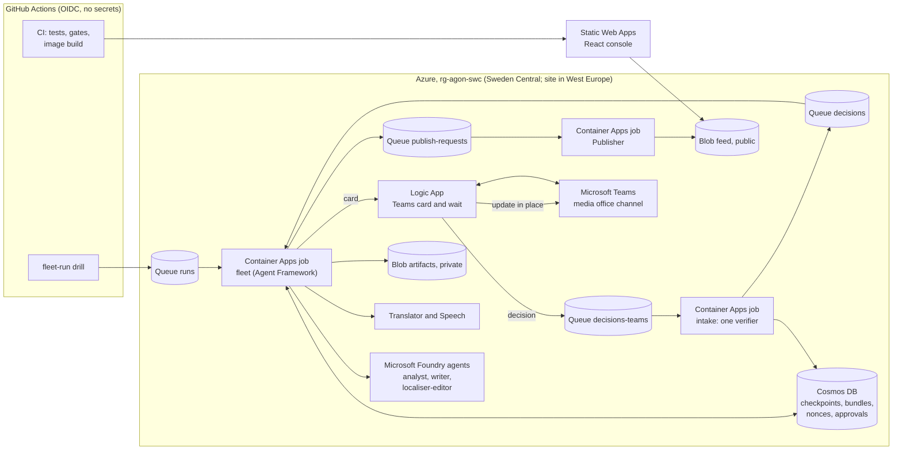

# Agon

**Agon publishes nothing until the club's media officer approves the exact checked bundle in Microsoft Teams, so a one-person media office can put out a four-language, easy-read and audio match report without copying numbers by hand or waiting for translators.**

Live demo, no login: https://jolly-stone-0c9c8a003.4.azurestaticapps.net

Agon (the contest) is our entry to the Microsoft Inside the Game developer hackathon. It serves the small media office of a professional football club. Every club, player and match in it is synthetic and fictional. MIT licence.

## Who it is for, where it lands, what it replaces

* **Who:** the one to three people in a club media office who must publish the match report, translated supporter bulletins, accessible versions and a feed item for the club website in the hour after full time.
* **Where it lands:** the media office's Microsoft Teams channel. When a match is over, a run starts (today an operator dispatches it, because there is no live match feed) and an approval card arrives there; the officer asks for nothing. It shows the bundle hash, the editions, the English report the officer attests, the sentences that need a tick, and the destinations to publish to. One tap publishes those exact bytes to the club's own channels.
* **What it replaces:** writing the report by hand after the match while copying numbers from a stats sheet, waiting for volunteer translators, and skipping easy-read and audio editions.

## Why Microsoft is load-bearing

Microsoft Foundry agents (analyst, writer, localiser-editor), run as a Microsoft Agent Framework workflow, write the report and post-edit every translation, and the workflow waits in a durable checkpoint until the media officer approves in Microsoft Teams. Take Foundry out and no report exists; take the Agent Framework checkpoint out and an approval cannot survive the process ending; take Teams out and nothing can publish to the club feed in this deployment.

## A real run, end to end (2026-10-19)

Everything below ran inside our Azure resource group; the ids are recorded in the project state file and the run can be checked by anyone from the public files.

| Time (UTC) | Step |
|---|---|
| 21:18:59 | A run for synthetic seed 1, match 0 is put on the `runs` queue ([drill run](https://github.com/upgradedev/agon-azure/actions/runs/39326468664)). |
| 21:19:06 | The fleet job wakes. Foundry agents `agon-analyst:1`, `agon-writer:1` and `agon-localiser-editor:1` write the report; Azure AI Translator and Azure AI Speech make the Greek, Spanish and French editions and the audio; code checks every number, name and minute and blocks real names; the bundle is sealed as sha256 `c8a19020c98a8de7dab58475bc0b2466129d3de771e30fd8ec519ab2716382dd`. |
| 21:20:30 | The approval card is posted to the club's Teams channel by an Azure Logic App. The worker process ends; the workflow waits in its checkpoint. |
| about 21:24 | The media officer approves in Teams. The decision goes to a queue that only the Logic App's identity may write. |
| 21:24:36 | The intake job runs the one verifier: nonce unused, not expired, approver role, hash equal to the sealed hash, consume once. |
| 21:25:06 | A new fleet process resumes the workflow from the checkpoint and asks for the publish. |
| 21:25:36 | The Publisher job recomputes the hash from the bytes, reads the approval record, and writes create-only to the public feed: recap page, JSON Feed and RSS, Instagram and YouTube previews (never posted), and the newsroom and journalist payloads. |
| 21:26:08 | The same Teams card is updated in place to "Published". |

Check it yourself: the [published manifest](https://stagonnnk4re3nvfz7o.blob.core.windows.net/feed/c8a19020c98a8de7dab58475bc0b2466129d3de771e30fd8ec519ab2716382dd/manifest.json) hashes to the approved hash (`sha256sum`), and the console's Verify page recomputes every file's sha256 in your browser.

## Real, simulated, not deployed

| Part | State |
|---|---|
| Synthetic league, season and matches (seeded, deterministic, standard library only) | real, in CI and on the site |
| Foundry agents writing the report, Translator, Speech | real, deployed in Sweden Central |
| Agent Framework workflow with Cosmos DB checkpoints, resumed in a new process | real, deployed (Container Apps jobs) |
| Teams approval card, updated in place after publish | real, deployed (Logic Apps Consumption) |
| One verifier for every approval route; consume once | real, deployed |
| Publisher, one adapter per destination, create-only writes | real, deployed |
| Club website recap, JSON Feed and RSS | real, published to the public feed container |
| Instagram and YouTube | preview payloads only: not posted; posting needs Meta and Google app approval |
| Newsroom Teams post and journalist email digest | payloads written; the sending flows are not built yet |
| Outlook approval email | built; not deployed until the officer authorises the Outlook connection |
| Public console | real; the approval card on it is a stand-in that sends no decision in this public build |
| Live run started from the public page, sandbox publish | not deployed yet |
| Interpret metrics (xG, xT, win probability) feeding the agents | code and tests exist; the deployed run used a stand-in interpret step, so no report claim rests on them yet |
| Key Vault signing, Event Hubs, replayer, matchfacts MCP deployment | not deployed |

## Architecture



Each job has its own managed identity and only the grants it needs: the fleet may create a nonce but never consume one; only the intake, as `id-api`, can consume a nonce and record an approval; only the Logic App's identity may write the decision queues; only the Publisher may write the public feed. Every runtime call uses a managed identity; no running component holds a key.

## Numbers (self-measured)

| What | Value | Command and run |
|---|---|---|
| Same synthetic data on two operating systems (M1) | seeds 1 to 3 combined sha256 `1dc93944eadc37731416524a588b5c309120e2fdc9b058baf62aed6815e36ebc` on ubuntu-latest and windows-latest; season 1 sha256 `0d5a4629fee516f8170e9aedc6c1a34272ce1939fb4dfb8df3b4825ca226b8db` on both | `python -m agon.synth.manifest --seeds 1,2,3 --print-hash`; `python -m agon.synth.season --season 1 --print-hash`; [determinism run](https://github.com/upgradedev/agon-azure/actions/runs/39330327746) |
| Realism bands on 200 held-out matches (M2) | 18 of 22 pass; our target was 20, so this is below target and no band was widened | `python -m agon.synth.bands --seeds 1001-1200` |
| Approval routes that skip the verifier (M16) | 0 (4 channel adapters, 2 queue routes) | `python -m agon.governance.routes`; [governance run](https://github.com/upgradedev/agon-azure/actions/runs/39330327770) |
| 50 concurrent approvals of one nonce (M15) | 1 approval; an etag-blind store, the negative control, lets several through | `pytest tests/approval_concurrency -q`; [governance run](https://github.com/upgradedev/agon-azure/actions/runs/39330327770) |
| Approval across process death | the 2026-10-19 run resumed in a new Container Apps execution; the CI spike kills the waiting process, resumes in another, and proves a deleted checkpoint cannot resume | [spike run](https://github.com/upgradedev/agon-azure/actions/runs/39229376155) |
| Foundry model call from CI (gate C2) | HTTP 200 from the luna deployment, 1409 ms, 35 tokens | [foundry-smoke run](https://github.com/upgradedev/agon-azure/actions/runs/39276078687) |
| Turning-point recall (M7) and Fact Gate catch rate by language (M8) | not built yet | none |

These numbers come from our own runs and are labelled as such; nobody else has measured them.

## Run it

Nothing needs installing on your machine to browse the demo. To check the code, the generator and the gates use the Python standard library:

```
python -m agon.synth.manifest --seeds 1,2,3 --print-hash
python -m agon.governance.routes
python ci/check_dashes.py
python ci/web_check.py web
```

The full test suite, the Agent Framework tests, the Azure SDK contract tests and the console build run in GitHub Actions (`.github/workflows/`). Deployment is Bicep (`infra/`) applied by the deploy workflow with a GitHub OIDC identity that holds Contributor on one resource group; Azure role assignments are in `infra/rbac.bicep` and are applied by the subscription owner. `docs/OPERATIONS.md` has every step.

## Honest limits

* One approver role, set by the subscription owner; the approver identity comes from the Teams responder field the Logic App forwards, a stated trust boundary.
* Foundry groundedness evaluation is not run yet. The Greek, Spanish and French editions are checked by the deterministic Fact Gate, not by a model.
* No penetration test, no multi-tenancy, no watermark in the audio. AI authorship is disclosed on every published page and at the start of every audio file.
* The realism score (M2) is below our own target.

## Open-source tooling

Python: pytest and its dependencies, setuptools, Microsoft Agent Framework (`agent-framework-core`, `agent-framework-foundry`, `agent-framework-openai`, `agent-framework-azure-cosmos`), `azure-ai-projects`, `azure-ai-inference`, `openai`, `aiohttp`, the Azure SDK (`azure-cosmos`, `azure-identity`, `azure-core`, `azure-storage-queue`, `azure-storage-blob`) and the MCP Python SDK (`mcp`). Exact versions are pinned in `requirements/` and `pyproject.toml`. CI uses the gitleaks container image and the GitHub Actions `actions/checkout`, `actions/setup-python`, `actions/setup-node`, `actions/upload-artifact`, `actions/download-artifact` and `azure/login`.

Console (`console/`), exact versions in `console/package.json` and `console/package-lock.json`: React and React DOM, TypeScript, Vite and @vitejs/plugin-react, Tailwind CSS and @tailwindcss/vite, Radix UI primitives (@radix-ui/react-dialog, @radix-ui/react-popover, @radix-ui/react-tooltip), Lucide icons (lucide-react), the Inter typeface through @fontsource-variable/inter, Vitest, Playwright (@playwright/test), axe-core through @axe-core/playwright, and the type packages @types/react, @types/react-dom and @types/node.

The public console is built from `console/` in a job with no Azure identity, prerendered into static HTML, checked by `ci/web_check.py` and the live readiness gate, and served by Azure Static Web Apps under a strict content security policy with Trusted Types.
